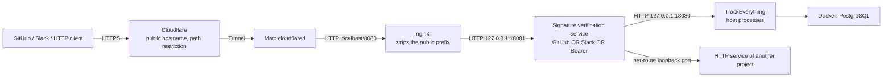

# Cloudflare Tunnel and the shared HTTP entry point

This is the source of truth for the public route, ports, deployment, and operations. For the signature
verification and forwarding contract, see the [shared HTTP gateway](../gateway/README.md); for the app API, see the
[FastAPI management doc](components/FASTAPI.md); for webhook payloads, see the
[configuration reference](CONFIGURATION.md#webhook-ingress).

## Route and responsibilities



The Cloudflare administrator configures the public hostname and the access restriction on the URL prefix.
The local side owns nginx, authentication, and forwarding to the upstream, and does not use URL keys or cookies for
authentication. Stripping the prefix in nginx is routing, and a matching prefix is never an authentication condition.
Locally, `/healthz` also passes without the prefix when a valid signature or Bearer token is present.

`cloudflared`, nginx, and the verification service are independent processes on the Mac. The verification service
does not import TrackEverything's agents, database, or host, and runs independently of app restarts.
The app owns HTTP interpretation and agent startup.

## Ports and where they are configured

| Role | Address | Configured in |
|---|---|---|
| Public entry | `https://track.example.com/<public-prefix>/…` | Cloudflare public route and path restriction |
| Tunnel Service URL | **`http://localhost:8080`** | Cloudflare public route |
| Shared nginx | `127.0.0.1:8080` / `[::1]:8080` | `nginx.conf` generated by `gateway/setup.py` |
| Authentication and HTTP forwarding | `127.0.0.1:18081` | The LaunchAgent from the same setup, `server.py --port 18081` |
| TrackEverything upstream | `127.0.0.1:18080` | The gateway's `routes[].upstream` and the app's environment variables |
| PostgreSQL | `127.0.0.1:5432` (the Compose `db` service) | `TE_DB_PORT` / `DATABASE_URL` |

`<public-prefix>` stands for `public_path_prefix` from the owner-only configuration, without the leading `/`.
Never store the real value in Git. The `.env` for an environment that uses the gateway is:

```dotenv
WEBHOOK_HOST=127.0.0.1
WEBHOOK_PORT=18080
```

The app reads `WEBHOOK_HOST` / `WEBHOOK_PORT` (the `WEBHOOK_PORT` default in `scripts/run_local.sh` is `18080`).
Start exactly one queue process and one runtime process for the same PostgreSQL database and Redis namespace.

The listen ports of the shared entry point and the verification service are fixed values in `gateway/setup.py`.
`gateway_port` / `auth_port` in `config.json` are used for the forwarding-loop check and do not change what is
listened on. To change these ports, regenerate setup's nginx config, startup arguments, and loop-check values together
with the Cloudflare Service URL.

## Cloudflare public route

Follow [Cloudflare's creation guide](https://developers.cloudflare.com/cloudflare-one/networks/connectors/cloudflare-tunnel/get-started/create-remote-tunnel/)
and configure **Networking → Tunnels → Routes → Published application** for the target tunnel.

| Field | Setting |
|---|---|
| Subdomain / Domain | `track` / `example.com` |
| Service protocol | `HTTP` |
| Service address | `localhost:8080` |
| Service URL | `http://localhost:8080` |
| Public path and restriction | Allow `/<public-prefix>` and everything under it; deny all other paths |

When restricting the path with a regular expression, the reference setting is `^/<public-prefix>(/.*)?$`.
Do not add a route that passes all paths on the same hostname; deny requests outside the scope.
When configuring a final ingress rule, use `http_status:404`.
See [Cloudflare's ingress matching rules](https://developers.cloudflare.com/cloudflare-one/networks/connectors/cloudflare-tunnel/do-more-with-tunnels/local-management/configuration-file/#how-traffic-is-matched).
The Cloudflare dashboard is the source of truth for the concrete path regex and edge rules of an existing
environment; this document records the reference for reconfiguring them and the acceptance criteria for connectivity.

The Service URL specifies the protocol and the local address. The public prefix goes into the path condition or the
edge access restriction. A tunnel's path setting only matches and does not rewrite the path, so in this setup nginx
strips the prefix. The dashboard's assets and API are referenced by paths relative to the document URL
(`static/js/…`, `api/…`), so they resolve with or without the prefix.
For an entry without the trailing "/" after the prefix, nginx adds it back with `302 <prefix>/`.
See [Cloudflare's path routing](https://developers.cloudflare.com/cloudflare-one/networks/connectors/cloudflare-tunnel/get-started/create-remote-tunnel/#2a-publish-an-application).

The GitHub Payload URL is `https://track.example.com/<public-prefix>/webhook/github`, and the Slack Request URL is
`/webhook/slack` under the same public prefix.
For route conditions and access restrictions, verify both that the correct prefix is allowed and that paths outside
the scope are denied.

## Authentication and upstream headers

On normal paths, a request is forwarded when **any one of a GitHub signature, a Slack signature, a Bearer token, or an
issued session cookie** is valid. If all are invalid, the response is 401. An invalid header of another method never
cancels a valid authentication.
Arbitrary URL keys or cookie values chosen by a third party do not pass, and a browser that carries nothing gets 401
from the address bar alone.
On the Mac, use `http://localhost:18080/` and enter the app's `WEBHOOK_TOKEN` in the dashboard's connection settings
(this field does not add the gateway's Bearer).
To open the dashboard from a remote browser, use the "one-time login key" below.

Normal PR review reports, generated documents, and issue investigation reports at
`/<public-prefix>/reports/<hex64>.html`, and the pinned Mermaid asset at
`/<public-prefix>/reports/assets/<sha256>/mermaid.min.js`, are readable anonymously, for GET / HEAD only.
Recipients of a report link can view it repeatedly without logging in, and anyone they forward it to can view it too.
This exception is limited to `public_read_patterns` on the target app route. The management API, listings, other
static assets, write methods, and the one-time contract of the dashboard login key stay in force.

| Method | What the client sends | Local setting |
|---|---|---|
| GitHub | `X-Hub-Signature-256` and the raw body | Make `credentials.github_secret` match the GitHub webhook Secret |
| Slack | `X-Slack-Signature`, `X-Slack-Request-Timestamp`, and the raw body | Set the Slack App's Signing Secret in `credentials.slack_signing_secret`. Clock skew of 300 seconds or less |
| Bearer | `Authorization: Bearer <token>` | `credentials.bearer_token` |
| Session cookie | (sent automatically by the browser) | Issued through the "one-time login key". 7 days by default |

### One-time login key + shared password (for remote browsers)

For an ordinary browser that cannot add headers, the owner, who holds existing credentials, issues a one-time key.
Opening the URL shows an input page for a fixed password, and the gateway hands out a session cookie and revokes the
key **only when both the key and the shared password are correct**.

```bash
curl -fsS -H 'Authorization: Bearer <bearer-token>' http://localhost:18081/__gateway__/login-key
# {"key": "...", "path": "/<public-prefix>/login/...", "url": "https://track.example.com/...", "expires_in": 180, "password_configured": true}
```

- The source of truth for the shared password is `GATEWAY_LOGIN_PASSWORD` in `.env`.
  `uv run gateway/setup.py --upstream-env .env --start` syncs it into `credentials.login_password` in `config.json`
  and applies it (unlike WEBHOOK_TOKEN, every run overwrites it with the current value; if the value is undefined or
  empty, the existing value is kept).
  **While it is unset, the login entry is closed** (the input page shows a notice with 503).
- A key is valid for 180 seconds (3 minutes) by default and **is revoked as soon as the password passes (one-time)**.
  A wrong password does not consume the key, but 8 wrong attempts per key revoke it.
  Link preview crawlers such as Discord's fetch a URL that a bot posts in chat before the person does, so the gateway
  returns a no-op to crawler User-Agents (such as Discordbot) without a form or cookie, and agents post the URL inside
  backticks as a code span (so no preview fetch happens). Opening `path` (or `url`) in a browser redirects with 303 to
  `../` (directly under the public entry), and from then on that device is forwarded with the
  `__Host-gateway-session` cookie (7 days by default, HttpOnly, Secure, SameSite=Lax). The dashboard's connection
  settings need no token (the gateway injects the internal token).
- Keys and sessions exist only in the verification service's memory. To revoke them, run
  `launchctl kickstart -k "gui/$(id -u)/com.sharedgateway.auth"` (discards all sessions) or wait for them to expire.
- To include `url` in the response, set the public origin (for example `https://track.example.com`) in
  `public_origin` in `config.json` (`gateway/setup.py --public-origin …`).
- The same issuing endpoint is also exposed to the Discord conversation agent as the `issue_gateway_login` tool.
  When the owner asks for a login URL, the agent issues one and replies with the URL
  (the app reads the Bearer from private configuration; failure messages never contain secret values).
- Reserved paths (`/login/…`, `/__gateway__/…`) are not forwarded upstream, and cookies are not passed upstream.

The Bearer and GitHub Secret are generated during the first setup. Get the Slack Signing Secret from the Slack App and
set it. It is a different value from the Slack API token, and while it is empty, Slack signatures cannot authenticate.
Details and the official specifications behind them are collected in the
[gateway's authentication contract](../gateway/README.md#authentication-contract).

When forwarding, the gateway keeps the raw body, signature headers, and query, and removes the gateway's Bearer header.
The TrackEverything route adds `headers.X-Webhook-Token` so the request passes the app's `WEBHOOK_TOKEN`
authentication. External clients do not need to send this internal token. After authentication, the upstream API
still decides whether the request succeeds.

## Secrets and startup

| Location | Contents |
|---|---|
| `.env` | App environment variables, `WEBHOOK_TOKEN`, `CLOUDFLARE_TUNNEL_TOKEN` |
| `~/Library/Application Support/TrackEverything/cloudflared/tunnel-token` | Tunnel connection token read by the always-on `cloudflared` |
| `~/Library/Application Support/SharedGateway/config.json` | Public prefix, credentials for the three methods, routes, upstream headers |
| `nginx.conf` / `server.py` / `logs/` in the same directory | Generated nginx config, deployed copy of the verification service, local logs |
| `~/Library/LaunchAgents/` | Plists for `com.trackeverything.cloudflared`, `com.sharedgateway.auth`, and `com.sharedgateway.nginx` |

Owner-only directories are 700; secret settings, tokens, logs, and plists are 600.
Never copy real values into public material. When renewing the tunnel token, update both `.env` and the token file
used by the always-on service.

After installing nginx and cloudflared and preparing the project's uv environment, run the following from the
repository root. The prefix must match the Cloudflare restriction.

```bash
brew install nginx cloudflared
uv run gateway/setup.py --upstream-env .env --public-prefix "/<public-prefix>" --start
```

Setup keeps existing credentials and routes, validates the nginx syntax, and then starts the two LaunchAgents.
On the default app route (`prefix=/`, `upstream=http://127.0.0.1:18080`) it sets the anonymous read patterns for
report HTML and the pinned Mermaid asset. For a custom upstream, set them on the target route according to the
[gateway's configuration contract](../gateway/README.md#configuration-contract).
`--upstream-env .env` imports `WEBHOOK_TOKEN` only when the config is first created.
When changing the token, also update `routes[].headers.X-Webhook-Token`.
The LaunchAgents start the services at login and restart them after abnormal exits.

Report publishing settings go in the running app's `.env`.

```dotenv
REPORTS_BASE_URL=https://track.example.com/<public-prefix>/reports
# REPORTS_DIR defaults to data/review-reports in the running checkout (the deploy checkout for the always-on service)
```

Replace `REPORTS_BASE_URL` with the real public HTTPS URL. When it is unset or invalid, publishing fails and a short
notification is returned. After restarting the app and redeploying the gateway, confirm that finished reports and the
assets they reference can be read with anonymous GET / HEAD. Report files are kept permanently and return 404 after
manual deletion.
Reports and pinned assets return `Cache-Control: private, no-store, no-transform`.
`no-transform` prevents body rewriting along the relay path and the automatic beacon injection of Cloudflare Web
Analytics ([Cloudflare's official FAQ](https://developers.cloudflare.com/web-analytics/faq/)).
When verifying the public route, also confirm that the body fetched over HTTPS is identical to the local pinned file.

While FastAPI is stopped, past reports cannot be read either. The nginx access log masks report paths and does not
record queries.

When registering the connector on a new Mac for the first time, first set the `CLOUDFLARE_TUNNEL_TOKEN` issued by the
Cloudflare administrator in `.env`. The following script creates the token file and plist for the always-on service;
register them with `launchctl bootstrap` as described below. The gateway setup does not create this connector.

```bash
python3 - <<'PY'
import os
import plistlib
import shutil
from pathlib import Path

os.umask(0o077)
values = dict(line.split("=", 1) for line in Path(".env").read_text().splitlines()
              if "=" in line and not line.startswith("#"))
token = values.get("CLOUDFLARE_TUNNEL_TOKEN", "").strip().strip("\"'")
executable = shutil.which("cloudflared")
if not token or not executable:
    raise SystemExit("Prepare the tunnel token and cloudflared first.")
directory = Path.home() / "Library/Application Support/TrackEverything/cloudflared"
directory.mkdir(parents=True, exist_ok=True)
directory.chmod(0o700)
token_file = directory / "tunnel-token"
token_file.write_text(token + "\n")
token_file.chmod(0o600)
agent = Path.home() / "Library/LaunchAgents/com.trackeverything.cloudflared.plist"
agent.parent.mkdir(parents=True, exist_ok=True)
agent.write_bytes(plistlib.dumps({
    "Label": "com.trackeverything.cloudflared",
    "ProgramArguments": [executable, "tunnel", "--no-autoupdate", "run", "--token-file", str(token_file)],
    "RunAtLoad": True, "KeepAlive": True, "WorkingDirectory": str(directory),
    "StandardOutPath": "/dev/null", "StandardErrorPath": "/dev/null",
}))
agent.chmod(0o600)
PY
```

Start the app as described in the [project README](../README.md#run-the-application): after
`docker compose up -d db`, run `bash scripts/run_local.sh` in the foreground.
Use the same foreground run when starting on another Mac.
To manage the existing always-on service, see the [deployment rules](OPERATIONS.md#deployment).

## Update, restart, and stop

The app's always-on service automatically deploys pushes to GitHub `main`.
`com.trackeverything.autodeploy` checks at login and every 30 minutes and applies new fast-forward commits to
`~/Services/trackeverything`.
The same SHA changes nothing, and on a fetch failure, a history rewind, or a divergence, the current version stays.
For an immediate check, run `bash scripts/deploy.sh --remote` in the dev checkout.
For registration, logs, stopping, and manual deployment, see the [deployment procedure](OPERATIONS.md#deployment).

Updates to the five version-owned folders (`agent/`, `tools/`, `skills/`, `harnesses/`, `sources/`) do not restart
the app. Running import in the deploy checkout after deployment makes them main, and runs that start afterwards use
them ([procedure](OPERATIONS.md#component-repository)).
For updates to the app's other Python code, dependencies, or `scripts/run_local.sh`, the supervisor waits for accepted
work and then restarts.
Static dashboard files take effect when the browser reloads.
Changes to `scripts/run_service.sh` and `.env` require a manual app restart, and deployment applies Alembic schema
migrations in the deploy checkout ([Deployment](OPERATIONS.md#deployment)).

To change credentials or routes, edit `config.json` and restart the authentication service.
To change the public prefix, change the Cloudflare condition and apply it locally with
`uv run gateway/setup.py --public-prefix "/<public-prefix>" --start`.
After editing `public_path_prefix` in `config.json` or changing the source of `gateway/server.py`, regenerate and
redeploy with `uv run gateway/setup.py --start`.
The LaunchAgent runs a copy of `server.py` in the private directory, so source changes require a redeploy.

For the internal `WEBHOOK_TOKEN`, update both `.env` and the route header.
For the always-on service, drain and restart the queue process with the
[queue stop and restart procedure](components/QUEUE.md#startup-and-installation); for a foreground run, stop it and
rerun `bash scripts/start_queue.sh` so the environment variable change takes effect.
Then restart the authentication service and confirm that `GET /api/runs` with a valid Bearer returns 200.
`.env` is not among the files the supervisor watches for changes, so use a manual restart.

```bash
launchctl kickstart -k "gui/$(id -u)/com.sharedgateway.auth"
launchctl kickstart -k "gui/$(id -u)/com.sharedgateway.nginx"
launchctl kickstart -k "gui/$(id -u)/com.trackeverything.cloudflared"
```

To stop and re-register the always-on services, run the following. Do not run the always-on connector and a
foreground run at the same time.

```bash
launchctl bootout "gui/$(id -u)/com.trackeverything.cloudflared"
launchctl bootout "gui/$(id -u)/com.sharedgateway.nginx"
launchctl bootout "gui/$(id -u)/com.sharedgateway.auth"

launchctl bootstrap "gui/$(id -u)" "$HOME/Library/LaunchAgents/com.trackeverything.cloudflared.plist"
uv run gateway/setup.py --start
```

To inspect the connector's connection in the foreground, stop the always-on connector first, then run:

```bash
cloudflared tunnel --no-autoupdate run \
  --token-file "$HOME/Library/Application Support/TrackEverything/cloudflared/tunnel-token"
```

The public route cannot stay up while the Mac sleeps, logs out, or loses the network.
PostgreSQL's persistent data is kept in the `pgdata` volume of the Compose `db` service.

## Connectivity checks and troubleshooting

`GET /healthz` and GitHub's `ping` are check requests that do not start agents.
Real PR and Slack mention deliveries start agents, so use health for connectivity checks.
Health checks the HTTP route. To confirm the internal token matches and the management API is reachable, call
`GET /api/runs` with a valid Bearer.

| Check | Expected result |
|---|---|
| `http://localhost:8080/healthz`, no credentials | 401 |
| Same, valid Bearer | 200. Locally no prefix is required |
| `https://track.example.com/<public-prefix>/healthz`, valid Bearer | 200 |
| Same, no credentials | 401 |
| Anonymous GET / HEAD of a finished report and the pinned Mermaid asset | 200. The URL stays valid no matter how many times it is opened |
| Unknown report ID or deleted file | 404 |
| Anonymous POST, listing, or encoded path against reports | Rejected. No management API permission is granted |
| `/api/runs` under the correct public prefix, valid Bearer | 200. Confirms the internal token and the connection to the management API |
| Public `/healthz` or a different prefix, valid Bearer | Rejected by Cloudflare (403 / 404) |
| `POST /webhook/github` with a valid GitHub signature, `X-GitHub-Event: ping` (with `X-GitHub-Delivery`) | 202. Published as the raw event; the dispatch agent runs no child |
| Opening the login key URL (before entering the password) | 200 with the password input page |
| Submitting the correct password | 303, then the dashboard returns 200 with the cookie. The key is revoked |
| Submitting a wrong password | 401 and the input page again (the key is not consumed). 8 attempts revoke the key |
| The same login key URL after success or after expiry | 401 |
| Calling login key issuance without credentials | 401 |

Replace `<bearer-token>` with the value from the private configuration.

```bash
curl -i http://localhost:8080/healthz
curl -fsS -H 'Authorization: Bearer <bearer-token>' http://localhost:8080/healthz
curl -fsS -H 'Authorization: Bearer <bearer-token>' \
  'https://track.example.com/<public-prefix>/healthz'
lsof -nP -iTCP:8080 -iTCP:18081 -iTCP:18080 -sTCP:LISTEN
```

Check DNS, the public route, and public path rejection on the Cloudflare side; 8080 is nginx, 18081 is signature
verification, and 18080 is the app. A gateway upstream connection failure is 502, and a timeout is 504.
If the management API returns 401 even after authentication passes, check that the upstream `WEBHOOK_TOKEN` matches the
route header.
The HTTP body limit is 32 MiB. For log locations and the logging policy, see the
[gateway doc](../gateway/README.md#forwarding-and-logging).

## Forwarding to another service

Add a route like the following to `routes` and restart the authentication service.
The longest prefix wins, and the three authentication methods are shared by all routes.

```json
{"prefix":"/services/other","upstream":"http://127.0.0.1:19090","strip_prefix":true,"headers":{}}
```

For the public `/<public-prefix>/services/other/items`, nginx strips the public prefix, and after authentication the
service prefix is also stripped, so the request is forwarded to `http://127.0.0.1:19090/items`.
Upstreams are limited to loopback HTTP/HTTPS URLs with an explicit port.
Set TrackEverything's internal token only on that project's own route.

## Queue / runtime process boundary

The TrackEverything upstream 18080 is owned by the queue process (`python -m trackeverything.api`).
The runtime process (`python -m trackeverything.core.builtin`) has no HTTP listener. The Cloudflare, nginx, and
authentication service settings and ports stay as they are.
For the first switch, drain the old `com.trackeverything.svc` and then register the two new queue/runtime services.
For credentials and generating service definitions, see [queue startup](components/QUEUE.md#startup-and-installation).
During a normal runtime update, the queue keeps storing webhook and SDK input and waits for execution to resume.
