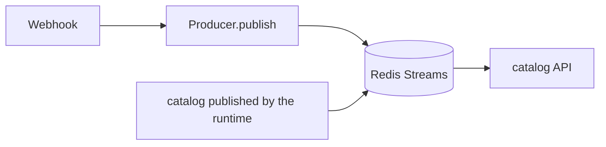

# FastAPI management API and dashboard

[Docs index](../README.md) / [components](README.md) / [core](../core/README.md)

[http://localhost:18080/](http://localhost:18080/) is the TrackEverything dashboard.
It adds the management API and static HTML routers to the FastAPI / uvicorn server of the queue process.
The header nav switches between Run flow (`#/runs`, the default view), Agent / Tool catalog (`#/catalog`), and Usage
stats (`#/usage`). Unknown hashes go to Run flow.

## Features

### Public pages (PR reviews, documents, issue investigation reports)

The Host serves HTML documents and pinned Mermaid assets already stored in `REPORTS_DIR` using the routes below.
Application components create, sanitize, publish, and notify about these files; the default component set has no page
publisher. Their publication and notification policies are documented in the [component repository](../EXTENSIONS.md#development-and-reviews).
This section owns the Host's file access and HTTP response contract. Optional anonymous forwarding through the gateway
is configured in [Public route operations](../CLOUDFLARE_TUNNEL.md).

| Upstream path (GET / HEAD) | Content |
|---|---|
| `/reports/<hex64>.html` | A finished HTML document |
| `/reports/assets/<sha256>/mermaid.min.js` | The pinned Mermaid asset saved when the document was published |

IDs and hashes must match exactly 64 lowercase hex characters; percent encoding and extra path segments are rejected.
Aliases of the configured root itself are allowed, and each element below it is opened without following symlinks.
The file is read from the same descriptor that was verified to be a regular file, which prevents reading an outside
file swapped in after the check. GET returns the full body; HEAD returns the same-length headers and an empty body.
Missing files, files deleted by hand, and invalid paths are 404; other methods are 405. There is no report index and no
generic static mount.

Responses carry `Cache-Control: private, no-store, no-transform`, `Referrer-Policy: no-referrer`,
`X-Content-Type-Options: nosniff`, and `X-Robots-Tag: noindex, nofollow, noarchive`.
The CSP inside the document is pinned together with the script hashes at publish time, and the HTTP header adds
`frame-ancestors 'none'`. `no-transform` forbids body rewriting along the route and suppresses Cloudflare Web Analytics'
automatic beacon injection ([Cloudflare FAQ](https://developers.cloudflare.com/web-analytics/faq/)).
The uvicorn access filter in the queue process entry `api/__main__.py` replaces report paths and queries with
`/reports/[redacted]` and keeps the access log of regular API calls. If the diagram asset cannot be loaded, the body
and the diagram source code are still readable.
Pages cannot be viewed while the app is stopped; after a restart with the same persistent storage, old links work
again.

### Agent / Tool catalog (`#/catalog`)

- Views are switched in the header nav, and the hash (`#/runs`, `#/catalog`, `#/usage`) holds the current view.
- The registered configuration comes from `GET /api/catalog`: the running graph (every agent of the `main` component
  graph, `ComponentGraph.agents`, with the child names each class declares and its tools and harnesses), combined with
  declared but unconnected classes found by scanning the `trackeverything.agent` / `tools` / `harnesses` packages.
  For an unconnected agent class, its children are shown from the names declared in `agents`.
  Only class attributes are read; no agent runs and no payload is fetched.
- The initial Diagram mode is a fixed-layout SVG of the shared execution contract. The top row numbers the success
  path from input to result; the bottom row shows the LLM, tool, and child-agent calls and returns, the shared Context
  and step budget, and the refusal and budget-exhausted results.
  Node explanations are shared with Execution flow; selecting a node highlights its connecting lines and shows details
  below the diagram. The PNG export button renders a 2560×1300 image in the current color scheme. Moving dots and the
  selection state are not included in the image.
- Execution flow and the connection views are drawn with Mermaid 11.12.2. Path motion of the dots in every mode uses
  Anime.js 4.5.0. Both are bundled at pinned versions in `static/js/vendor/` and lazy-loaded on display (no CDN).
  For sources, integrity hashes, and licenses see [Bundled assets](../../src/trackeverything/api/static/js/vendor/README.md).
  Execution flow shows Source / Webhook → Queue → Runtime → Pre Harness → Agent → Post Harness → result, plus the
  standard loop's LLM, tool, and child-agent calls and returns. Early refusal and non-ok branches are shown too.
  The source of truth for the shared contract is [ARCHITECTURE.html](../ARCHITECTURE.html) and `core/abc/agent.py`.
  Delegation graph shows Source / Webhook → entry agent → child-agent delegation. Tool usage is a bipartite
  agent → tool graph that groups unconnected tools in a frame. Automatic shrinking stops at 80%; below that, scroll
  inside the diagram. Buttons zoom in, zoom out, and fit to frame width.
- Lines in each diagram flow, and Anime.js `svg.createMotionPath()` moves up to 24 dots along the paths at once.
  Play / pause and 0.5× / 1× / 2× are available. The motion is a schematic of direction, not actual throughput, speed,
  or run history. It stops off-screen, in another tab, or on another view, and becomes a static diagram under
  `prefers-reduced-motion: reduce`. Anime.js instances are destroyed when a diagram is redrawn. Searching or expanding
  rows does not redraw the diagram.
- A node is selected by click or Enter / Space and shows its role, input and output, child agents, tools, pre / post,
  arguments, and implementation. In Mermaid modes the details sit next to the diagram (below it on narrow screens).
  Execution-step explanations are fixed UI text; registered descriptions are shown as is.
  The Mermaid source toggle shows the diagram definition (in Diagram mode, the Mermaid form of the same execution
  contract). If Anime.js fails to load, the SVG / Mermaid diagrams remain.
- The development-time skills `visual-explainer` (information structure and detail views) and `impeccable` (motion,
  readability, operability) guide the page design. They are development procedures, not runtime dependencies of the
  page.
- Each agent / tool / harness / Source row expands to show name, description (the original LLM-facing description),
  badges (entrance, webhook receiver, child agent, unconnected), an argument summary, and the implementing module.
  Clicking a chip searches for that name.
- Search (name, description, module), section visibility toggles, and an unconnected-only filter are available.
  The token uses the shared connection settings, and a 401 leads to the connection settings panel.

### Usage stats (`#/usage`)

- Lists call counts per agent and tool. The data is `GET /api/usage`, which aggregates `agent` / `tool` events in the
  `logs` table by component name (`by_status` counts per status, `last_used_at` is the last run, and `agents_since` /
  `tools_since` are the first records in the aggregated range).
  It is an ORM aggregate (`core/builtin/execution_log.read_usage`) and runs no LLM or agent.
- The view joins this with the registered list from `GET /api/catalog` by name, so registered agents and tools that
  have never been called appear with 0 calls. Names that exist only in the aggregate (old agents and tools that are no
  longer registered, or unknown names an LLM specified) get a "not currently registered" badge.
  If fetching the catalog fails, only the aggregate is listed and no badge is shown.
- Each row has the name, the registered description, the call count (descending; ties by name), the status breakdown
  (`ok` first, then by count; "never run" when there are no calls), and the last run (in the browser's time zone).
  Search by name and description and a manual refresh are available; there is no 5-second auto-refresh.
  The summary pills in the heading show the total calls of agents and of tools.
- Recording of `tool` events starts with runs from 2026-10-06, so earlier tool calls are not counted. A note at the
  bottom of the view shows this boundary as the aggregated range.
  The source of truth for the recording boundary is [LOGGING.md](../LOGGING.md). The token shares the connection
  settings with the other views.

### Run flow (`#/runs`)

- Entering a run ID or session ID queries `GET /api/runs/{id}` and, only on 404, `GET /api/sessions/{id}`. The
  displayed ID goes into `#/runs/<encodeURIComponent(ID)>` and can be shared.
  `#/runs` lists the latest 20 runs from `GET /api/runs` (entry agent, status, start, duration, step count, session);
  selecting one opens it.
- A run switches between Structure (default), Sequence, and Timeline. Structure has four columns (Agent, LLM, Tool,
  Skill). The same agent name, LLM model, tool name, or skill function is one block, and each call adds an arrow from
  its caller with a number (start order; failures are `✗`). A block shows the count, total time, and failures (plus cost
  for LLMs); selecting it lists the calls with number, time, duration, status, and excerpt.
  Skills group the `read_skill` (reading the body) and `skill__<skill name>__<function name>` tool events into one
  frame per skill.
  Sequence is a Mermaid flowchart of start → agent frames (LLM, tool, and child agents chained in start order) →
  result, where each node has a name, duration, and status (color and symbol). Steps whose parent agent was not recorded
  are grouped as an unrecorded run.
  Timeline is a Mermaid gantt of bars at real times that highlights failures. Zoom in / out (automatic fitting down to
  80%) and the Mermaid source are available.
- Playback (Structure and Sequence) uses a monotonic time mapping that compresses start and end times logarithmically.
  It lights up steps (blocks and arrows in Structure) in order while preserving order and nesting, and dots travel
  along the lines (4 to 45 seconds at 1×). It has play / pause, restart, speed, a position slider, and the real
  elapsed time, and while playing it follows the most recently started step. It does not animate under
  `prefers-reduced-motion`, in a hidden tab, or off-screen.
- Selecting a node shows status, start, duration, tokens, cost, error cause, and an excerpt of up to 300 characters
  (tool arguments, the agent's response, or the tool name or answer the LLM chose). The API does not return LLM or
  agent requests.
- A session is a left-to-right diagram of its runs in start order (latest 50, with the number omitted); selecting a run
  shows its flow below. The latest run is shown initially. Refresh is manual only; there is no 5-second auto-refresh.
  The specification is [Dashboard spec](DASHBOARD_SPEC.md).

## Layout and responsibilities

| File | Responsibility |
|---|---|
| [`api/auth.py`](../../src/trackeverything/api/auth.py) | `X-Webhook-Token` check shared by all routers (`require_token`) |
| [`api/catalog.py`](../../src/trackeverything/api/catalog.py) | `GET /api/catalog`. The connection graph and declarations of running agents, tools, harnesses, and Sources (feeds the catalog view) |
| [`api/usage.py`](../../src/trackeverything/api/usage.py) | `GET /api/usage`. Call-count aggregate of agent / tool events in `logs` (feeds the usage view; the aggregation itself is `core/builtin/execution_log.read_usage`) |
| [`api/runs.py`](../../src/trackeverything/api/runs.py) | `GET /api/runs`, `GET /api/runs/{run_id}`, `GET /api/sessions/{session_id}`. Shapes run summaries, steps, excerpts, and error causes (feeds the run-flow view; reads with `core/builtin/execution_log.read_*`) |
| [`api/webui.py`](../../src/trackeverything/api/webui.py) | Serves the shell HTML at `GET /` and assets at `GET /static/*` (path traversal is 404) |
| [`api/reports.py`](../../src/trackeverything/api/reports.py) | Serves only finished reports and the pinned Mermaid asset anonymously at `GET / HEAD /reports/…` |
| [`api/static/index.html`](../../src/trackeverything/api/static/index.html) | Shell with the CSS and HTML skeleton. Loads `static/js/` |
| [`api/static/js/api.js`](../../src/trackeverything/api/static/js/api.js) | Contract layer (`DashboardApi`) for `/api/catalog` `/api/usage` `/api/runs` `/api/sessions`. One function per endpoint and response classification (failures keep the HTTP status) |
| [`api/static/js/app.js`](../../src/trackeverything/api/static/js/app.js) | Parts shared by all views. Saves and restores the connection-settings token, injects it into `api.js`, and selects the default view (run flow) |
| [`api/static/js/usage-model.js`](../../src/trackeverything/api/static/js/usage-model.js) | Pure logic of usage stats. Matches /api/usage with /api/catalog, sorts, and builds the status breakdown |
| [`api/static/js/usage.js`](../../src/trackeverything/api/static/js/usage.js) | Controller of the usage view. Fetches on arrival at `#/usage`, renders the aggregate table, filters by search |
| [`api/static/js/catalog-model.js`](../../src/trackeverything/api/static/js/catalog-model.js) | Pure logic of the catalog. Execution-contract explanations, Mermaid diagram assembly, search, argument summaries |
| [`api/static/js/catalog-poster.js`](../../src/trackeverything/api/static/js/catalog-poster.js) | Fixed-layout SVG of the shared execution contract. Shared as the image source of the browser diagram and the PNG export |
| [`api/static/js/catalog.js`](../../src/trackeverything/api/static/js/catalog.js) | Controller of the catalog view. View switching (3 views), fetching, SVG / Mermaid rendering, PNG export, zoom, node details, Anime.js playback control |
| [`api/static/js/runs-model.js`](../../src/trackeverything/api/static/js/runs-model.js) | Pure logic of run flow. Step tree, assembly of Mermaid flowchart / gantt / session diagrams, playback time mapping and per-time state, display formatting |
| [`api/static/js/runs.js`](../../src/trackeverything/api/static/js/runs.js) | Controller of the run-flow view. ID resolution (run → session), recent runs, rendering, playback (requestAnimationFrame), following, step details |
| [`api/static/js/vendor/mermaid.min.js`](../../src/trackeverything/api/static/js/vendor/mermaid.min.js) | Locally bundled Mermaid 11 (no CDN; loaded only when the catalog or run flow is displayed) |
| [`api/__main__.py`](../../src/trackeverything/api/__main__.py) | Entry point of the queue process. Configures logging and redacts report URLs in the uvicorn access log |
| [`integration/webhook/__init__.py`](../../src/trackeverything/integration/webhook/__init__.py) | The FastAPI app, `/healthz`, one webhook route per connector with the shared intake (token, JSON validation, 422 / 503, durable publishing of the raw event), and mounting of extra routers |
| [`api/http.py`](../../src/trackeverything/api/http.py) | Configures, starts, and stops the uvicorn server. Signals are owned by the queue process |
| [`core/builtin/runtime.py`](../../src/trackeverything/core/builtin/runtime.py) | Transport-independent read loop, execution of each message, and waiting for completion on stop |
| [`core/builtin/app.py`](../../src/trackeverything/core/builtin/app.py) | Composes the execution side: Runtime, QueueConsumer, version store and its periodic sync, maintenance tick, the child-request Producer |

The dashboard needs no frontend framework, build step, or CDN.
The management routers are read-only and never trigger agent / LLM runs or Source payload fetches.

## Wiring as plugins

`api/app.py` connects the intake connectors, the Producer, and the stored catalog to HTTP.
The queue process entry `api/__main__.py` only configures logging and starts the server. The runtime process entry
`core/builtin/__main__.py` builds no HTTP.



The management API does not start or stop the Host.
A new router goes in `api/<resource>.py` and is added to `extra_routers` in `api/app.py`.
`GET /api/catalog` reads the snapshot stored in Redis and returns `code_version / as_of / online`.
The view does not treat its fetch time as evidence that the runtime is alive; it shows the stored time and that an
update is pending.
Before anything is published it returns an empty list; after the runtime stops it returns the last snapshot.

There is no HTTP API for queue operations. Publish with the SDK and CLI described in [Queue](QUEUE.md#publishing).
A webhook awaits completion of the Producer's publish, not the start or end of the agent. A Redis failure is 503.

## HTTP contract

| Method and path | Success response | Operation |
|---|---|---|
| `GET /` | 200 HTML | Serves the dashboard |
| `GET /api/catalog` | 200 JSON | The agents, tools, harnesses, and Sources the runtime stored in Redis, with their connections, plus `code_version / as_of / online`. Returns the last snapshot while the runtime is stopped and an empty list before its first start. The queue side never imports or runs components |
| `GET /api/usage` | 200 `UsageView` | Call counts aggregated by component name from `agent` / `tool` events in `logs` (per-status counts, last run, aggregated range). DB reads only; nothing runs |
| `GET /api/runs` | 200 `RunListView` | Summaries of the latest runs (ordered by their last record in `logs`). `limit` is 1 to 100 (default 20). DB reads only |
| `GET /api/runs/{run_id}` | 200 `RunDetailView` | The run summary (status from the root agent, then `session_run`, then `incomplete`) and its steps in start order (status, duration, cost, tokens, error cause, 300-character excerpt). Up to 400 steps (`truncated`). LLM and agent requests are not returned. 404 if found in neither `logs` nor `session_run` |
| `GET /api/sessions/{session_id}` | 200 `SessionView` | The session and summaries of its latest 50 runs in start order. `total_runs` is the total count. Unknown sessions are 404 |
| `GET /healthz` | 200 `{"ok": true}` | Liveness of the shared HTTP server |

Error JSON is `{"detail": "..."}`.
`/healthz` reports only that the HTTP process is alive. `/readyz` reports whether a Redis `PING` succeeds. A stopped
runtime does not lower readiness.
`/docs`, `/redoc`, and `/openapi.json` are disabled when the app is created.
GitHub webhooks are only format-checked at `/webhook/github` and published as raw events; the runtime's dispatch passes
every one to `github`, and the github agent decides delegation to business children or ignoring the event.
Input fetching and agent runs happen in the runtime's work units; HTTP waits only until the message is durably
enqueued.
For per-provider webhook payloads and responses see [Configuration](../CONFIGURATION.md#webhook-ingress).

## Authentication and startup

The app listens on `WEBHOOK_PORT` (default `18080` in `scripts/run_local.sh`) and is the upstream of the shared
gateway. For the shared nginx entry and signature / Bearer authentication see [gateway/README.md](../../gateway/README.md).
The Tunnel's Service URL, ports, startup, and connectivity checks are collected in
[Public route operations](../CLOUDFLARE_TUNNEL.md).
On the shared entry `8080`, `/`, the dashboard's static assets, and `/healthz` also require a signature, Bearer token,
or gateway session. The two report GET / HEAD routes are published anonymously through the route's
`public_read_patterns`. This exception does not apply to the management API, webhooks, login-key issuance, or any other
resource.
The `WEBHOOK_TOKEN` contract below is the app upstream's authentication, and the gateway adds it as a route header.
When `WEBHOOK_TOKEN` is non-empty, `/api/*` and `/webhook/*` require an `X-Webhook-Token` with the same value. When it
is empty, nothing is authenticated. The static HTML at `GET /`, `/healthz`, and the report GET / HEAD routes are exempt
from the app upstream's token check.
The dashboard's token field is in the connection settings, and its value is stored in `te_token` in same-origin
`localStorage`. On an authentication failure the connection settings expand and show a 401 notice. The token is never
written to result or error bodies.

For startup see the [project README](../../README.md#run-the-application).
The app upstream can be checked with the following GETs.
For checks through the gateway, follow the Bearer examples in the operations document above.

```bash
curl -fsS http://localhost:18080/healthz
curl -fsS http://localhost:18080/api/runs
# Where WEBHOOK_TOKEN is set, add the X-Webhook-Token header.
```

## Verification scope and evidence

`tests/api/test_information.py` checks report viewing, the catalog, usage stats, run-flow retrieval, and
authentication. It sends requests through TestClient and mocks the aggregation services and reads.
Only the pinned reports are checked for viewability with temporary files. DB state transitions and stopping the Host
are outside the guaranteed scope.

The dashboard uses the 8 scenarios in `tests/browser/dashboard_logic.test.cjs`, which check the catalog and usage
stats, the run-flow diagrams, playback and selection, and the display of interruptions with real JavaScript and DOM /
fetch stubs. They use only the Node.js 18+ standard library and run inside pytest through
`tests/browser/test_dashboard.py`.
For details see [Business tests](../BUSINESS_TESTS.md).
