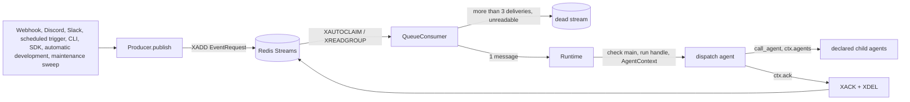

# Redis Streams queue and independent execution processes

[Docs index](../README.md) / [Shared contracts](../ARCHITECTURE.html) / [Component versioning](VERSIONING.md) / [Scheduling](SCHEDULING.md) / [Business tests](../BUSINESS_TESTS.md)

This document is the source of truth for the queue, intake, the execution request (`EventRequest`), and the runtime
process that executes it.

The queue runs on redis-py basic commands only. It has no Lua, idempotency keys, capacity checks, claim deadlines,
claim generations, PostgreSQL execution evidence, or child-process registry. It does not handle complex cases and
accepts the [tolerated errors](#tolerated-errors). There are no recurring tracking subscriptions. The
[scheduled trigger](#scheduled-trigger) follows the cron definitions in the PostgreSQL `schedule` table and the one-shot
reservations in the `reservation` table, and the queue process publishes a [named run](#internal-payload). The
application jobs are defined by the installed components and registered explicitly; a fresh installation has no
application schedules. See [scheduled components](../EXTENSIONS.md#scheduled-components) and the Host-owned
[Optimizer](OPTIMIZER.md).

## Structure and owners

The producing queue process starts with `python -m trackeverything.api`, and the executing runtime process starts
independently with `python -m trackeverything.core.builtin`. The start scripts are `scripts/start_queue.sh` and
`scripts/start_runtime.sh`. Redis and PostgreSQL are separate services. Each process runs on one asyncio event loop.
Operations run exactly one queue and one runtime against the same DB and namespace; there is no lock that prevents a
second instance.



| Component | Location | Owning process |
|---|---|---|
| Publish entry point (JSON encoding of the execution request `EventRequest` and `XADD`) | `queue/producer.py`, `queue/contracts.py`, `core/abc/submission.py` | queue intake, SDK, CLI, runtime automatic development and maintenance sweep |
| Redis operations (publish, read, reclaim, ACK, dead, catalog) | `queue/redis_stream.py` | both |
| Fetching one message (reclaim, delivery count, dead, decoding) and ACK | `queue/consumer.py` | runtime |
| HTTP and intake SDKs (format validation, pruning by identity, publishing the raw event) | `api/` (including the composition `api/app.py` and the HTTP server `api/http.py`), `integration/` | queue |
| Scheduled trigger (reading the `schedule` and `reservation` tables, polling, publishing) | `integration/schedule.py`, `queue/models.py` | queue |
| Choosing the delegate for every request, re-verifying authorization, ACK | `agent/dispatch.py` (the version-owned dispatch agent) | runtime |
| Read loop, concurrency limit, converting a request into an AgentContext, recording `session_run`, passing the ACK function, waiting for completion on stop | `core/builtin/runtime.py` | runtime |
| Process entry, signals, watched paths | `api/__main__.py`, `core/builtin/__main__.py`, `process.py`, `scripts/start_queue.sh` and `start_runtime.sh`, `scripts/run_service.sh` | each process manages only itself |
| Publish command (`publish`) | `queue/cli.py` | one-shot process that starts no always-on service |

`queue/consumer.py` belongs to the queue package, but the queue process does not start it.
The HTTP authentication proxy routes in `gateway/` and the Discord SDK Gateway connection are separate from execution.

## Redis keys

| Key | Type | Content |
|---|---|---|
| `te:{<namespace>}:queue` | stream | Unprocessed messages. Field `data` is the JSON of the execution request (`EventRequest`) |
| `te:{<namespace>}:dead` | stream | Messages that exceeded the delivery limit or could not be read. Fields `id` (the original stream id), `data`, `reason` |
| `te:{<namespace>}:catalog` | hash | The runtime's component catalog (`snapshot`) and `heartbeat` |

`<namespace>` is `QUEUE_NAMESPACE`. The consumer group and the consumer are both named `runtime`.
Keys of the earlier implementation (`messages`, `dlq`, `index`, `idempotency`, `terminal`, `index:catalog`) are neither
read nor deleted.

## Publishing

- `XADD te:{<namespace>}:queue * data <execution request JSON>`. The returned stream id is the message's only ID
  (`message_id`).
- There is no deduplication. Publishing the same input twice runs it twice as two separate messages.
- The single publish entry point is `Producer.publish(EventRequest)`. Intake, the scheduled trigger, the SDK, the CLI,
  automatic development, and the maintenance sweep all use it. The receipt is
  `{"message_id": <stream id>, "accepted_at": <time of the stream id (seconds)>}`.
- A Redis failure raises `QueueUnavailableError`. Intake HTTP returns 503 and does not report acceptance.
- There is no size limit on a request (single-host operation). Messages hold JSON only and never carry callables, SDK
  objects, or authorization objects.

### Execution request `EventRequest`

This is the only execution request the queue carries (`core/abc/submission.py`). Unknown top-level fields are
rejected, and trusted values (`authorization`, `run_id`) cannot be part of a request.

| Field | Content |
|---|---|
| `kind` | `"event.handle"` (default). Identifies messages in the old formats (`agent.run`, `source.run`) as unreadable |
| `provider` | `github` / `discord` / `slack` / `internal` |
| `external_id` | Stable ID from the publisher (required, 1 to 256 characters). Not used for deduplication |
| `payload` | JSON object (default `{}`). For external providers, the raw event |
| `session_id` / `parent_session_id` | Session and parent decided by the publisher. None when absent |

The payload carries the event type: GitHub uses `headers.x-github-event`, Slack uses `type` and `event.type`, and
Discord uses the shape of `d` (an interaction has `application_id` and `data`; a message has `author` and `content`).

### Internal payload

`internal` identifies requests published by something other than an external service. The Producer validates the
`EventRequest` envelope and leaves payload interpretation to the installed dispatch.
The package's default dispatch supports this named-run payload:

| Field | Meaning |
|---|---|
| `agent_name` | Required child name, `general` or `optimizer` in the default version |
| `request` | Optional request passed to the child |
| `data` | Optional object used as `ctx.data`; defaults to `{}` |

An undeclared name or non-object `data` produces a dispatch error at run time and is ACKed. Without `agent_name`, the
default dispatch sends the event's content/request or serialized payload to `general`.
Source selection, automatic development, and application-specific aliases are contracts of an installed component
dispatch, documented in its `docs/components/DISPATCH.md`; see [component ownership](../EXTENSIONS.md).
They are not additional formats interpreted by the Host or the default dispatch.

```python
from trackeverything.queue import EventRequest, Producer

async def submit() -> str:
    async with Producer.from_env() as producer:
        receipt = await producer.publish(EventRequest(
            provider="internal", external_id="sdk:investigation-1", session_id="cli:investigation",
            payload={"agent_name": "general", "request": "Investigate the target"},
        ))
    return receipt.message_id
```

The SDK does not start the runtime, HTTP, or intake SDKs. Closing the connection is owned by the async context manager
or `close()`. The CLI has exactly one command and starts no always-on service.

```bash
bash scripts/run_local.sh python -m trackeverything.queue.cli publish --file message.json
```

The CLI validates the JSON as an `EventRequest`, publishes it, and prints the receipt as JSON. It accepts any
provider, so the `data` of a dead-stream entry can be republished as is once the cause is fixed. It rejects the old
formats (`kind` of `agent.run` or `source.run`); rewrite those into the new shape. Example using the default components:

```json
{"provider": "internal", "external_id": "cli:example-1",
 "payload": {"agent_name": "general", "request": "Investigate the target"}}
```

There is no HTTP API for queue operations, no message status query, and no dedicated command to list or republish dead
messages. Read the dead stream with Redis commands
(for example `docker compose exec redis redis-cli XREVRANGE 'te:{trackeverything}:dead' + - COUNT 20`).

## Consumption

`Runtime` receives messages one at a time from `QueueConsumer.next()` in a single loop and creates one task per message.

1. While `RUN_CONCURRENCY` tasks are running, it does not read.
2. `QueueConsumer.next()` uses `XAUTOCLAIM` (min-idle 1,800,000 ms, COUNT 1) to reclaim one pending message that has
   not been ACKed for 30 minutes or more, and reads its delivery count with `XPENDING`.
3. If nothing is reclaimed, it reads one new message with `XREADGROUP` (COUNT 1, BLOCK 1000 ms, `>`).
4. A message delivered more than 3 times is moved to dead without running. The first read is delivery 1 and each
   reclaim adds 1, so a message runs at most 3 times.
5. A message whose `data` cannot be read as an `EventRequest` (including the old `kind` values `agent.run` and
   `source.run`) is moved to dead without running.
6. Otherwise it returns the stream id and the execution request to the Runtime. When it moves a message to dead, it
   returns nothing.

- ACK is `XACK` followed by `XDEL`. ACKed messages do not stay in the stream.
- Moving to dead is an `XADD` to the dead stream followed by an ACK of the original message.
- Each operation sends its commands in order. Consistency after a failure in the middle is not maintained (the same
  message can enter dead twice).
- When the Runtime starts, `QueueConsumer.prepare()` creates the consumer group (`MKSTREAM`, id `0`; an existing group
  is kept).
- Each task starts in a context with `REQUEST_ID` cleared. Its versions come from its own run handle and are not
  inherited from the caller's run.
- On stop, the Runtime stops new reads within 1 second, waits for the running tasks to finish, and then closes the
  version store. Unacknowledged messages stay pending.
- A loop iteration whose Redis read fails is logged, waits 1 second, and the next iteration reads again.

## Execution and ACK

For each message the Runtime:

1. Calls `repo.refresh()` to check the DB `main`, and creates the run handle with `repo.run()`. The run handle keeps,
   for each name, the version first resolved until the run ends. `session_run` is recorded with the version of the
   entry agent `config.DISPATCH_AGENT`.
2. Creates the `AgentContext`:
   - `run_id`: newly issued for every run (32 hex digits).
   - `session_id`: the message's `session_id`, otherwise a newly issued one (32 hex digits).
   - `parent_session_id`: the message's value, otherwise None.
   - `data`: `{"event": {"provider", "external_id", "payload"}}`. The request is None.
   - `max_steps`: `MAX_STEPS`. `authorization`: None (the dispatch agent sets it after re-verification).
   - `message_id` and `acknowledger`: the stream id and the stream's ACK (an in-process value, never part of JSON).
   - `agents`: the run handle.
3. Records the start of `session_run` (`run_id`, `session_id`, `parent_session_id`, entry name, `data`, `request`).
   If this fails, the agent does not run and the result is a `session` error.
4. If `dispatch` is not an entrance of the version (`graph.entrances`), the result is the `entrance` error
   `unknown entrance: dispatch`.
5. Runs `await agent.run(AgentCall(ctx, request))` within `RUN_TIMEOUT` (default 3600 seconds). Exceeding the deadline
   gives a `cancelled` result with a `deadline` note; an unexpected exception gives an `execution` error.
6. Records the end of `session_run` (status and response). A recording failure is logged and does not change the
   result.
7. Releases the run handle with `repo.release(run)` (exactly once, however the run ends) and logs one line with the
   message ID, run_id, session_id, entry name, and status.

- The Runtime does not branch on provider or payload and does not reference Sources. Child agents are obtained by name
  through `call_agent` from `ctx.agents` (the run handle).
- `await ctx.ack(ctx.message_id)` sends `XACK` and `XDEL`. In a run that did not come through the queue it does
  nothing.
- The Runtime never ACKs. Only the dispatch agent ACKs, with `ctx.ack(ctx.message_id)` at the end of its handling,
  regardless of the child's result and including events it decided not to run.
- A message that ends without an ACK (no `dispatch` entrance in the version, failure to record the `session_run` start,
  an exception in dispatch itself, cancellation by `RUN_TIMEOUT`, a forced stop during execution) stays pending, is
  reclaimed after 30 minutes, and moves to the dead stream after more than 3 deliveries.
- If the task itself is cancelled (forced stop on shutdown), the Runtime tries to finish `session_run` as `cancelled`,
  re-raises the cancellation, and does not ACK.
- While a message runs, the Runtime puts its `message_id` in `REQUEST_ID`. Components publish follow-up requests with that
  message as parent through the Host's `publish_child(payload, key, *, session_id=None)` in `queue/child.py`: the
  request is `provider="internal"` with `external_id="<parent message_id>:<key>"`, and a call outside a queued run, before
  the runtime installed its Producer (`install`, done by `prepare_runtime_state`), or with an invalid request raises and
  publishes nothing. The component chooses the key and payload according to its own workflow.
- `RUN_TIMEOUT` is the only deadline that cancels a run.
- An explicit session is used as is; otherwise each run gets a new session. Every run records the start and end of
  `session_run`. Reclaimed messages follow the same rule and do not inherit the previous attempt's session.
- The Runtime and agents do not serialize business units such as sessions, PRs, or issues. Runs for the same unit also
  run concurrently ([locks](VERSIONING.md#locks)).
- Tool child processes are started with `spawn_exec` / `spawn_shell` in `core/builtin/process_registry.py` (thin
  wrappers around asyncio's process creation). The calling tool owns cleanup in `finally`; the shared
  `stop_process_group` helper lives in `core/builtin/base_tools.py`.
  There is no child-process record, no reaping at startup, and no blocking on unknown termination.

## Tolerated errors

- A message that runs longer than 30 minutes can be reclaimed while it is still running and run twice.
- A run cancelled by `RUN_TIMEOUT` is not ACKed and is run again after reclaim (up to 3 deliveries).
- A message whose runtime was force-stopped during execution does not run until it is reclaimed 30 minutes later.
- If Redis runs without AOF or with eviction, accepted messages can be lost.
- There is no deduplication. External redeliveries (such as GitHub redelivery) and repeated publishes by the
  maintenance sweep run as separate messages.
- External posts and Git operations are not guaranteed exactly once.
- The scheduled trigger does not run times that passed before or during startup, while stopped, or while the host was
  asleep, nor times whose publish failed (one-shot reservations included). Two queue processes publish the same time
  twice.

## Intake

Intake (the queue process) only validates the format, prunes by sender identity, and durably publishes the raw event.
It makes no decision based on content (event type, action, `custom_id` format, subtype, or body). The dispatch agent
decides the business route.

| Entry point | Validation (failure is 422, nothing is published) | Pruning | Publish |
|---|---|---|---|
| GitHub `POST /webhook/github` | `X-Webhook-Token` when configured (mismatch is 401). The body is a JSON object. `X-GitHub-Event` and `X-GitHub-Delivery` are present | None. `ping` and successful `workflow_run` are published too | `provider="github"`, `external_id`=`X-GitHub-Delivery`, `payload={"headers": {...}, "body": <raw body>}` |
| Slack Events API `POST /webhook/slack` | `X-Webhook-Token` when configured. The body is a JSON object. Everything except `url_verification` has `event_id` | `url_verification` returns `challenge` synchronously and is not published (protocol handshake) | `provider="slack"`, `external_id`=`event_id`, `payload`=raw body. No session |
| Slack Socket Mode | — | Only `events_api` deliveries whose `team_id` and `event.channel` match the configured values (metadata). A delivery without `event_id` is only ACKed | `provider="slack"`, `external_id`=`<team_id>:<event_id>`, `payload`=`request.payload`. ACK after a successful publish; no ACK on failure |
| Discord message | — | Drops bots (`author.bot`), webhooks (`webhook_id`), and anyone other than the owner (`author.id` ≠ `DISCORD_ALLOWED_USER_ID`). Empty messages are not dropped | `provider="discord"`, `external_id`=message ID, `payload`=the `d` of MESSAGE_CREATE, with session |
| Discord reaction | — | Only the owner's reactions (`user_id` = `DISCORD_ALLOWED_USER_ID`), including removals. The emoji and the reacted message are not judged. Bulk removals (`MESSAGE_REACTION_REMOVE_ALL` / `REMOVE_EMOJI`) are not received | `provider="discord"`, `external_id`=`<frame type>:<message_id>:<emoji name, or ID for a custom emoji>`, `payload`=the `d` of MESSAGE_REACTION_ADD / REMOVE, with session |
| Discord button | — | Only component interactions. An action by anyone other than the owner gets an ephemeral refusal and is not published (protocol response) | Owner: defer first, then publish the `d` of INTERACTION_CREATE with `external_id`=interaction ID and session. Success or failure of the publish is reported in a followup |

- GitHub `headers` keep only the allowlisted `x-github-event`, `x-github-delivery`, and `x-github-hook-id` (when
  present). `X-Webhook-Token` and the authentication headers injected by the shared gateway never enter Redis.
- A top-level `token` in the raw body (the Discord interaction token, the Slack verification token) is removed before
  publishing. All other fields are stored as received. SDK tokens and authorization objects are never put in a message.
- A body that is not JSON also gets 422.
- HTTP responses: on publish, 202 `{"ok": true, "run": "queued", "message_id", "accepted_at"}`; 503 when durable
  acceptance cannot be confirmed; 200 `{"challenge": ...}` for the Slack handshake. A webhook awaits the publish only,
  not the agent run.
- The Slack SDK ACK is returned after the durable publish; a delivery whose publish failed is not ACKed. The dispatch
  agent delegates the raw event to `slack`, which summarizes direct mentions of the owner and sends a Discord
  notification ([Slack](SLACK.md)).
- The always-on Discord connection exists once, in the queue process.
- A new intake puts only format validation and identity pruning in `integration/` and publishes the raw `EventRequest`.
  A new agent or Source is registered in `agent/compose.py`, and an agent started by a named run is declared as a child
  in the dispatch agent's `agents`. Do not implement Redis handling or custom retries.

### Capturing raw Discord events

discord.py 2.7.1 has no event that passes the raw MESSAGE_CREATE. The intake client runs with
`enable_debug_events=True`, and `on_socket_raw_receive` parses gateway frames (`op=0`).

- MESSAGE_CREATE: pruning is applied to the frame's `d`, which is then published.
- MESSAGE_REACTION_ADD / MESSAGE_REACTION_REMOVE: received with the `reactions` intent (guild and DM). Only the owner's
  `d` is published, unchanged; the frame type is kept only in `external_id`, because dispatch reconciles each rating
  with Discord's current state instead of trusting the event.
- INTERACTION_CREATE: `d` is held temporarily by interaction ID. The SDK's `on_interaction` handles the button response
  (defer within 3 seconds, followup) and, after deferring, takes the raw event with the same ID and publishes it. For
  one frame the SDK creates the raw-event task before it parses the frame synchronously and creates the interaction
  task, and tasks start in creation order, so the raw event is held before `on_interaction` runs. If the raw event is
  still missing after 5 seconds, nothing is published and a failure followup is sent.

### Discord sessions

- Messages in the general channel (`DISCORD_GENERAL_CHANNEL`, or `DISCORD_NOTIFY_CHANNEL` when unset) get no session,
  and the channel table is not read.
- Other channels get their session from `PostgresChannelStore.resolve_session("discord", channel_id)`, which creates a
  new one when no mapping exists. A message whose session cannot be resolved is not published.
- For a thread, the parent channel comes from the SDK cache (`client.get_channel(id).parent_id`), and
  `parent_session_id` is resolved the same way. When the parent is the general channel, no `parent_session_id` is set.

## Dispatch routing

Every version has a single entrance, `dispatch`; it declares the child names it can run. The Host does not choose a
business route. The [default dispatch](../../src/trackeverything/agent/dispatch.py) uses Python control and no LLM:

- An internal named run delegates to the declared `general` or `optimizer` child with `data` and `request`.
- Any other event goes to `general` with its non-empty `content` or `request`, or a JSON description of its payload
  limited to 20,000 characters.
- The dispatch ACKs at the end of handling, including an error result. `general` has no reply tool; its answer remains
  in the run records.

A component repository may supply its own dispatch and workflows for GitHub events, Discord conversations, Slack,
feedback, and scheduled jobs. Its `docs/components/DISPATCH.md` owns those routing rules. They do not change the Host's
raw intake, shared Context, version-resolution, or ACK contracts. See [component ownership](../EXTENSIONS.md).

## Scheduled trigger

The always-on connection `Connector("schedule")` of the queue process (`integration/schedule.py`) reads the PostgreSQL
`schedule` table and, at each cron time, publishes
`EventRequest(provider="internal", external_id="schedule:<id>:<fire time>", payload=<row payload>)`.
Rules and cases: [Scheduling](SCHEDULING.md).

| Column | Content |
|---|---|
| `id` | Name of the definition (primary key) |
| `cron` | 5-field cron expression (Debian cron semantics as interpreted by [cronsim](https://pypi.org/project/cronsim); day of week 0 and 7 are Sunday) |
| `timezone` | IANA time zone used to interpret the cron expression (default `Asia/Tokyo`) |
| `payload` | The payload of a [named run](#internal-payload) |

- There is no management API, screen, or CLI. Rows are inserted, updated, and deleted directly with SQL and take
  effect within 30 seconds. The queue never writes to the table.
- The poller reads the table at most every 30 seconds and decides fire times by wall-clock time (asyncio timers do not
  advance while macOS sleeps).
- The next fire time is kept in process memory only. A time more than 60 seconds late is not published and a warning
  is logged; past times are not made up.
- An invalid definition (cron expression, time zone, payload) is not published, and an error is logged once per
  definition. A publish failure logs an error and is not retried.

```bash
docker compose exec db psql -U trackeverything trackeverything -c \
  "INSERT INTO schedule (id, cron, payload) VALUES ('weekday-digest', '0 9 * * 1-5', '{\"agent_name\": \"general\", \"request\": \"Summarize the updates from yesterday\"}')"
```

### One-shot reservations

The same poller also reads the `reservation` table (`id`, `at`, `payload`, `created_at`) and publishes
`EventRequest(provider="internal", external_id="reservation:<id>:<at in UTC>", payload=<row payload>)` exactly once at
`at`. Rules and cases: [Scheduling](SCHEDULING.md).

- Rows are inserted with SQL or by installed components. The default components do not include reservation tools.
  The queue never writes to the table.
- A reservation already past when first read, or late by more than the grace period (60 seconds), is not published.
  After it fires or is skipped, it is not published again even if the row remains.
- Optional reservation components create named runs of `reservation_fire`, which deletes the row and then passes the instruction
  to the `general` conversation path. If the row is gone (cancelled, or redelivered), it does nothing. A row that
  remains after its time was skipped, is waiting to run, or failed, and the list shows it as `未実行` ("not run").
- The two tables are read separately, and a read failure of one does not affect the other.

## Startup and installation

```bash
docker compose up -d db redis
bash scripts/run_local.sh alembic upgrade head

# Start each in its own terminal. Neither starts the other process.
bash scripts/start_queue.sh     # python -m trackeverything.api
bash scripts/start_runtime.sh   # python -m trackeverything.core.builtin
```

The queue alone can receive and publish, and the runtime alone can consume messages left in the stream and new
publishes from the SDK and CLI. `/healthz` reports that the HTTP process is alive and `/readyz` reports whether a
Redis `PING` succeeds; a stopped runtime does not make it unready. The agent and Source catalog reads the runtime's
versioned stored data and shows its fetch time and liveness separately.

Generate the always-on service definitions with the following command. It does not register or start anything in
launchd.

```bash
uv run python scripts/render_services.py --directory "$HOME/Services/trackeverything" --output-dir data/launchd
```

The generated `com.trackeverything.queue.plist` and `com.trackeverything.runtime.plist` each start
`scripts/run_service.sh queue|runtime`, and that supervisor runs `scripts/start_queue.sh` or `scripts/start_runtime.sh`
as its child. Logs are `data/queue.log / queue.err.log / runtime.log / runtime.err.log` in the deploy checkout.
`process.restart_roles()` is the source of truth for what each supervisor watches: core execution code restarts the
runtime, intake and HTTP restart the queue, and the shared wire contract and dependency lock restart both.
Components are not in this repository: the runtime uses the `main` its mirror of the component repository adopted, and
a push to that repository reaches it without a restart ([Component versions](VERSIONING.md)).

### First switchover from the earlier always-on service

This switchover is a manual deployment step; implementing, testing, or generating the plists does not perform it.
The old plist calls the supervisor without arguments, so switch over once in this order.

1. Before publishing this change to main, pause automatic deployment. Confirm with
   `launchctl print gui/$UID/com.trackeverything.autodeploy` that no deployment is running, then run
   `launchctl disable gui/$UID/com.trackeverything.autodeploy` and
   `launchctl bootout gui/$UID/com.trackeverything.autodeploy`.
2. Get the old supervisor's PID with `launchctl print gui/$UID/com.trackeverything.svc`. Stop only the supervision with
   `launchctl kill SIGSTOP gui/$UID/com.trackeverything.svc`, and find its child app process group with
   `ps -axo pid,ppid,pgid,comm`. Confirm that the chosen PGID differs from the supervisor's own, then send
   `kill -TERM -- -<app PGID>`. The app stops accepting work and waits for accepted runs to finish. Because the
   supervisor is stopped, the app is not restarted.
3. Confirm the exit record in the old `data/service.log` and that the app's PGID is gone. Do not continue while
   unfinished runs remain. After it exits, run `launchctl bootout gui/$UID/com.trackeverything.svc` and move the old
   plist out of `~/Library/LaunchAgents/`. Confirm with `launchctl print` that the old label is not registered and with
   `ps` that the old app is gone. A run ended by a forced stop does not count as completed.
4. Deploy the verified commit to the deploy checkout with the normal deployment procedure. In the deploy checkout, run
   `docker compose up -d db redis` and `bash scripts/run_local.sh alembic upgrade head`.
5. In the deploy checkout, run the generation command above and place the two generated plists in
   `~/Library/LaunchAgents/`. Register each with
   `launchctl bootstrap gui/$UID ~/Library/LaunchAgents/com.trackeverything.queue.plist` and the same command for the
   runtime.
6. Check the PIDs of both labels, `/readyz`, and `online=true` in the catalog. The first switchover involves real agent
   runs, so keep it distinct from running a synthetic request.
7. Restore automatic deployment with `launchctl enable gui/$UID/com.trackeverything.autodeploy` and
   `launchctl bootstrap gui/$UID ~/Library/LaunchAgents/com.trackeverything.autodeploy.plist`.

A normal manual restart of only one process also uses this order: stop the target supervisor, send TERM to the child
app, confirm completion and exit, bootout, then bootstrap. `kickstart -k` does not wait for work to finish. When only
the queue or only the runtime changed, act on that process only.

## Storage settings and development environment

| Setting | Default |
|---|---|
| `QUEUE_REDIS_URL` | `redis://127.0.0.1:6379/0` |
| `QUEUE_NAMESPACE` | `trackeverything` |
| `RUN_CONCURRENCY` | `20` |
| `TE_REDIS_PORT` | `6379` (loopback publish in Compose) |
| `TE_REDIS_MAXMEMORY` | `512mb` (Redis byte limit) |

The reclaim idle time (1800 seconds) and the delivery limit (3) are fixed by `QUEUE_CLAIM_IDLE` and
`QUEUE_MAX_DELIVERIES` in `config.py`.

The recommended Redis settings are `--appendonly yes --appendfsync always --maxmemory-policy noeviction` with the
`redisdata` volume, which is the `docker-compose.yml` default. The app does not check Redis settings at startup or
publish time. ACKed messages are deleted; the dead stream is never deleted automatically. High availability against a
single disk failure and backups are outside this setup.

The PostgreSQL tables `subscription`, `schedule_cursor`, `schedule_outbox`, `execution_receipt`, `execution_attempt`,
and `execution_child` are unused (data retained). Only `subscription.project` is read, read-only, as a candidate
project label (`queue/project_labels.py`).

### Isolated development runs

For development, set both a dedicated DB and namespace, use port 18090, and blank the intake bot credentials. Never
connect development code to the production DB or namespace.

```bash
TE_DATABASE_URL='postgresql://…/trackeverything_dev' QUEUE_NAMESPACE=trackeverything_dev \
WEBHOOK_PORT=18090 DISCORD_BOT_TOKEN= SLACK_APP_TOKEN= SLACK_TOKEN= \
bash scripts/start_queue.sh
```

Start the runtime separately with `bash scripts/start_runtime.sh` against the same development DB and namespace. For
checks that involve notifications, also blank the runtime's Discord token and notification destination.
